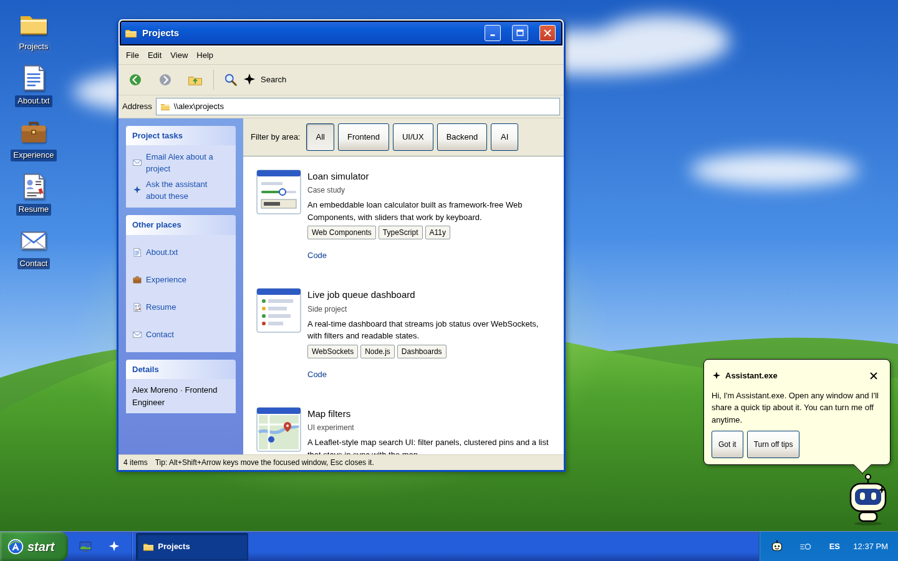
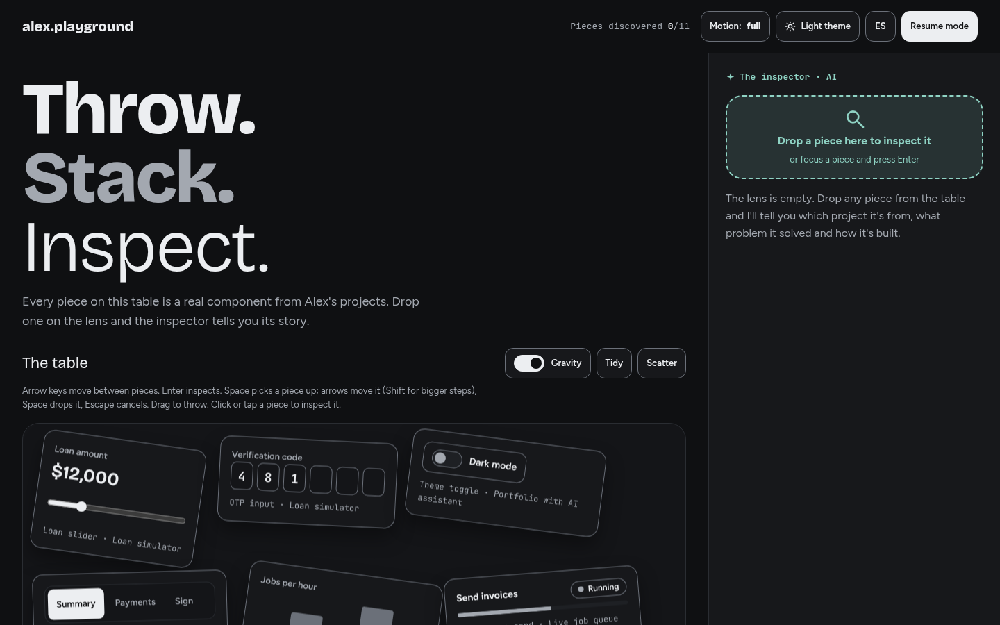
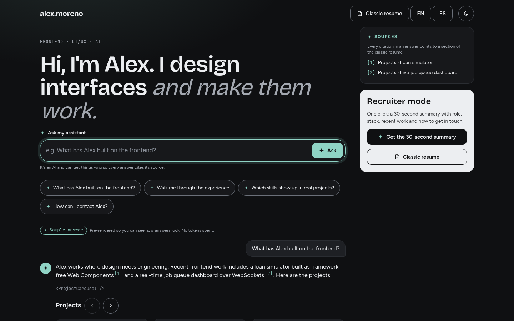
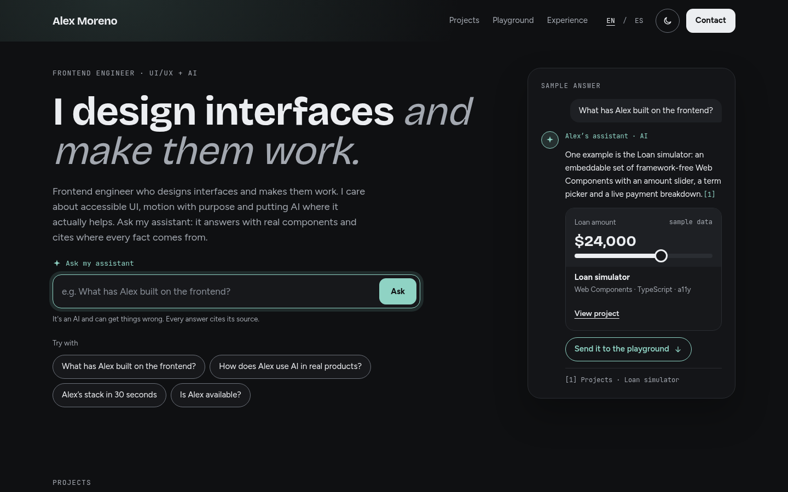
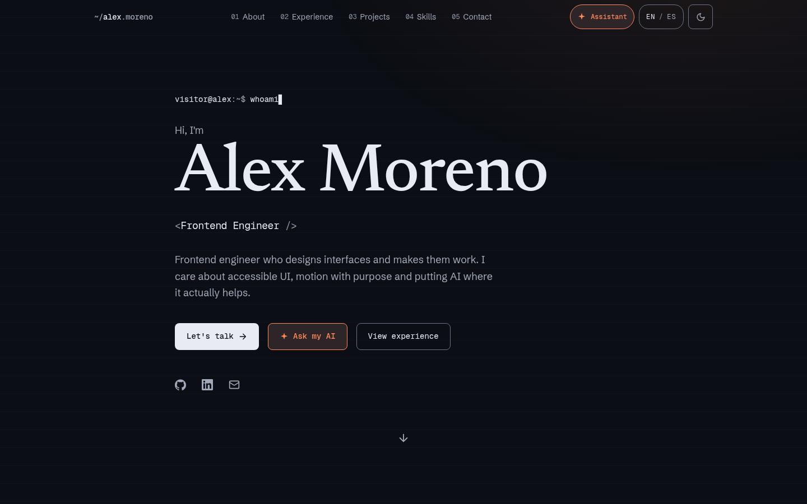

# Portfolio Ideas

Five working portfolio templates for developers who want their site to **show** their craft instead of
listing it, each with an AI assistant built in. Built with Astro and Tailwind CSS, accessible by default, and
usable with or without an API key.

Each template is a self-contained starter. Copy the one you like, replace the fictional profile with yours
and ship it.

| | Template | The idea | Where the AI lives |
|---|---|---|---|
| 01 | [`desktop-os`](templates/desktop-os) | Your portfolio is a retro-inspired desktop. Sections are windows you open, drag and stack. | A helper character that comments on the window you open, plus an AI search box in the Start menu. |
| 02 | [`ui-playground`](templates/ui-playground) | The landing page is a table of real UI components you can throw and stack with physics. | "The inspector": drop a component on the lens and it tells you its story, its states and its code. |
| 03 | [`generative-ui`](templates/generative-ui) | Chat-first landing. Answers arrive as real components: carousels, timelines, contact cards. | The whole page. Every answer cites its sources. |
| 04 | [`chat-playground`](templates/chat-playground) | A conversational hero for people in a hurry, a playground for people who want to explore. | The same assistant answers in the chat and in the playground, and can send a component from one to the other. |
| 05 | [`editorial-terminal`](templates/editorial-terminal) | A classic one-page portfolio with editorial type and a terminal-prompt motif. The simplest one to adapt. | An assistant modal with streaming answers, conversational memory and a one-click "recruiter mode" pitch. |

## Previews

<table>
  <tr>
    <td width="50%"><a href="templates/desktop-os"></a><br><b>01 · desktop-os</b></td>
    <td width="50%"><a href="templates/ui-playground"></a><br><b>02 · ui-playground</b></td>
  </tr>
  <tr>
    <td width="50%"><a href="templates/generative-ui"></a><br><b>03 · generative-ui</b></td>
    <td width="50%"><a href="templates/chat-playground"></a><br><b>04 · chat-playground</b></td>
  </tr>
  <tr>
    <td width="50%"><a href="templates/editorial-terminal"></a><br><b>05 · editorial-terminal</b></td>
    <td width="50%"></td>
  </tr>
</table>

## Quick start

```bash
npm create astro@latest -- --template JeanpiDev/portfolio-ideas/templates/generative-ui
cd <your-project>
npm install
npm run dev
```

Swap `generative-ui` for any template name. Each template's README covers its details.

The AI works out of the box in **demo mode** (canned answers grounded in your profile). Add an
`ANTHROPIC_API_KEY` to `.env` for live answers from Claude.

## Make it yours

Every template keeps everything you need to change in two files:

- `src/data/profile.ts`: your name, experience, projects and skills. The included person, **Alex Moreno**, is
  fictional. Replace every field, and don't keep placeholder results such as `[YOUR RESULT]`.
- `src/styles/global.css`: the theme tokens (colors, type, radii, motion) for dark and light mode.

## Principles shared by all templates

- **The accent color marks AI, and only AI.** Normal actions use the text color. AI elements also carry a spark
  icon, so color is never the only signal.
- **The site works without AI.** Projects, experience and contact are static HTML: they work without
  JavaScript, with the API down and for search engines.
- **The assistant doesn't make things up.** It answers only from your profile, cites where each fact comes from
  and says so when it doesn't know. It talks about you in the third person, so nobody mistakes it for you.
- **Accessible by default.** WCAG 2.1 AA contrast, everything usable with a keyboard and with a single pointer
  (no drag-only interactions), screen-reader-friendly streaming, and `prefers-reduced-motion` turns off
  physics and typewriter effects.
- **Progressive enhancement.** Physics, windows and animations are layered on top of a page that already works.

## Stack

Astro 7 · Tailwind CSS 4 · TypeScript · framework-free custom elements for the interactive islands ·
[`@anthropic-ai/sdk`](https://github.com/anthropics/anthropic-sdk-typescript) for the assistant ·
[`matter-js`](https://brm.io/matter-js/) for physics (templates 02 and 04) · self-hosted fonts via Fontsource.

## Contributing

Issues and pull requests are welcome, especially new concepts, accessibility fixes and translations. Keep new
templates self-contained and follow [`SPEC.md`](SPEC.md).

## License

[MIT](LICENSE). Concepts by [Jean Pierre Ramírez](https://jeanpi-ramirez.vercel.app).
